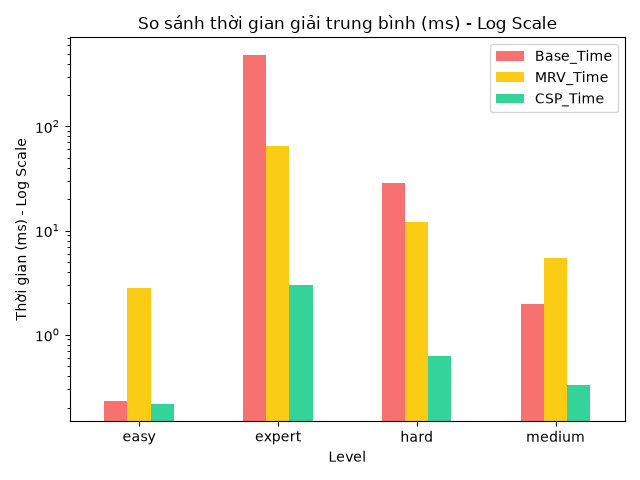
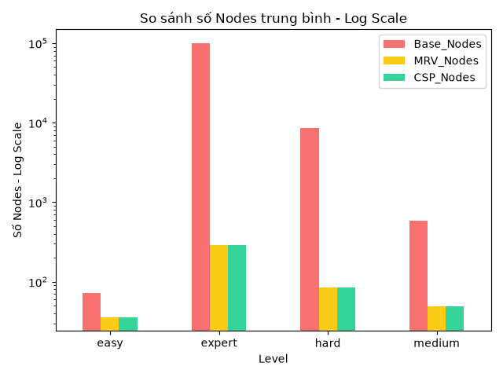

<div align="center">

# 🧩 SUDOKU SOLVER OPTIMIZATION

### Đồ án Nhập môn Tối ưu hóa: Đánh giá và Tối ưu hiệu năng thuật toán giải Sudoku


### 🎓 Khoa Công nghệ Thông tin

</div>

---

## 📖 1. Bài toán (Problem Statement)

Sudoku là một bài toán thỏa mãn ràng buộc (Constraint Satisfaction Problem - CSP) kinh điển. Mục tiêu là điền các số từ 1 đến 9 vào lưới 9x9 sao cho mỗi hàng, mỗi cột và mỗi khối 3x3 đều chứa đủ các số từ 1 đến 9 không trùng lặp.

Với cách tiếp cận vét cạn (Naive Backtracking), không gian tìm kiếm có thể lên tới \(9^{81}\), dẫn đến thời gian chạy cực kỳ chậm hoặc treo máy khi gặp các đề "Siêu Khó" (chỉ có 17-21 gợi ý). Đồ án này tiếp cận bài toán dưới góc độ **Tối ưu hóa**, nhằm tìm ra phương pháp giảm thiểu thời gian thực thi và số bước thử.

---

## 🧮 2. Mô hình hóa (Formulation)

Bài toán được mô hình hóa thành một bài toán tối ưu với các thành phần sau:

*   **Biến quyết định (Decision Variables):**
    Vector biến \(x\) đại diện cho ma trận Sudoku 9x9. Với mỗi ô \((r, c)\), giá trị được chọn là \(x_{r,c} \in \{1, 2, ..., 9\}\).
*   **Hàm mục tiêu (Objective Function):**
    Tối thiểu hóa thời gian chạy và số bước thử (Nodes).
    \[
 \min f(x) = Time(x) + Nodes(x) 
\]
*   **Ràng buộc (Constraints):**
    Nghiệm \(x\) phải thỏa mãn:
    *   Ràng buộc hàng: \(x_{r,1} \neq x_{r,2} \neq ... \neq x_{r,9}\) (với mọi hàng \(r\)).
    *   Ràng buộc cột: \(x_{1,c} \neq x_{2,c} \neq ... \neq x_{9,c}\) (với mọi cột \(c\)).
    *   Ràng buộc khối 3x3: Các số trong mỗi khối 3x3 không trùng lặp.
*   **Ràng buộc tài nguyên (Budget):**
    Thời gian chạy tối đa cho mỗi thuật toán trên một đề bài là 5.0 giây (Timeout).

---

## ⚙️ 3. Phương pháp (Methods)

Dự án cài đặt và so sánh 3 thuật toán với mức độ tối ưu tăng dần:

1.  **Baseline (Naive Backtracking):**
    *   Duyệt từng ô từ trái sang phải, thử các số từ 1-9. Nếu sai thì quay lui (backtrack).
    *   *Nhược điểm:* Không gian tìm kiếm khổng lồ, cực kỳ chậm ở mức Khó/Siêu Khó.
2.  **MRV Scan (Minimum Remaining Values):**
    *   Sử dụng Heuristic: Trước khi điền, quét toàn bàn cờ để tìm ô có ít lựa chọn hợp lệ nhất và ưu tiên điền ô đó trước.
    *   *Ưu điểm:* Giảm mạnh số nhánh cây tìm kiếm.
3.  **CSP Tối ưu (Bitmask + MRV):**
    *   Kết hợp MRV với kỹ thuật **Bitmask** (Mặt nạ bit). Thay vì dùng vòng lặp `for` để kiểm tra ràng buộc, thuật toán dùng phép toán bit `&` (AND) để kiểm tra trong \(O(1)\).
    *   *Ưu điểm:* Tốc độ xử lý nhanh nhất, giảm số Nodes xuống mức tối thiểu.

---

## 📊 4. Kết quả chính (Key Results)

*(Dưới đây là kết quả thu được từ quá trình chạy thực nghiệm tự động 100 đề bài (25 đề x 4 mức độ) bằng Python)*

*   **Baseline:** Giải quyết tốt ở mức Dễ, nhưng bắt đầu quá tải ở mức Khó và thường xuyên bị Timeout (> 5000ms) ở mức Siêu Khó.
*   **MRV Scan:** Nhanh hơn Baseline hàng chục lần, giải quyết được mức Khó nhưng vẫn tốn thời gian ở mức Siêu Khó do overhead quét bàn cờ.
*   **CSP (Bitmask):** Vượt trội hoàn toàn. Giải quyết mức Siêu Khó chỉ trong vài mili-giây với số Nodes cực ít.

---

## 📷 5. Hình minh họa (Illustrations)

*(Các biểu đồ dưới đây được sinh tự động bởi file `analyze.py` từ kết quả thực nghiệm)*

### So sánh thời gian giải (Runtime)


### So sánh số bước thử (Nodes)


---

## 🚀 6. Cách chạy (How to Run)

### Yêu cầu môi trường
*   Python 3.8+
*   Các thư viện trong `requirements.txt`

### Bước 1: Chạy thực nghiệm và sinh dữ liệu (Python)
```bash
# Cài đặt thư viện
pip install -r requirements.txt

# Chạy 100 đề bài (25 đề/mức x 4 mức), xuất file CSV vào thư mục results/
python run_experiments.py

# Vẽ biểu đồ từ file CSV, xuất ảnh vào thư mục figures/
python analyze.py
